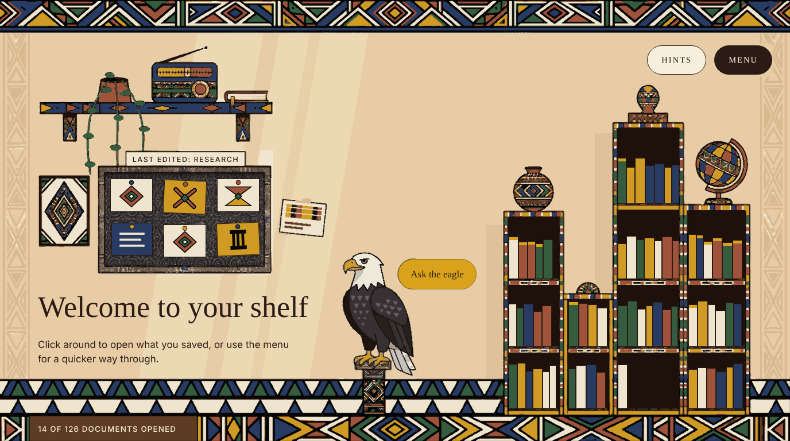
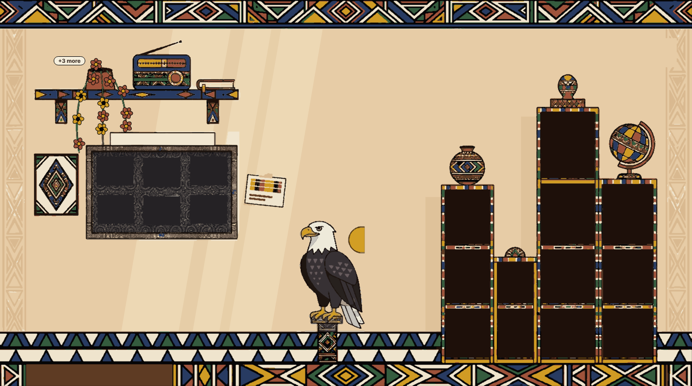
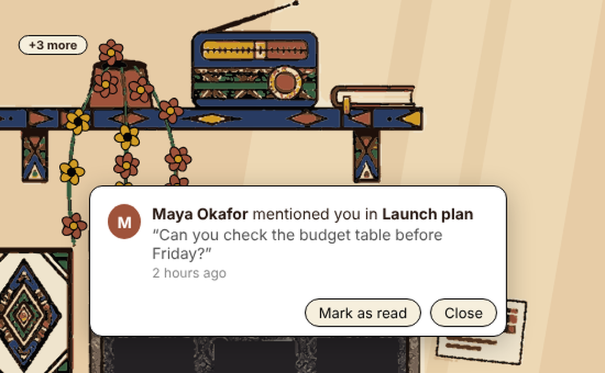
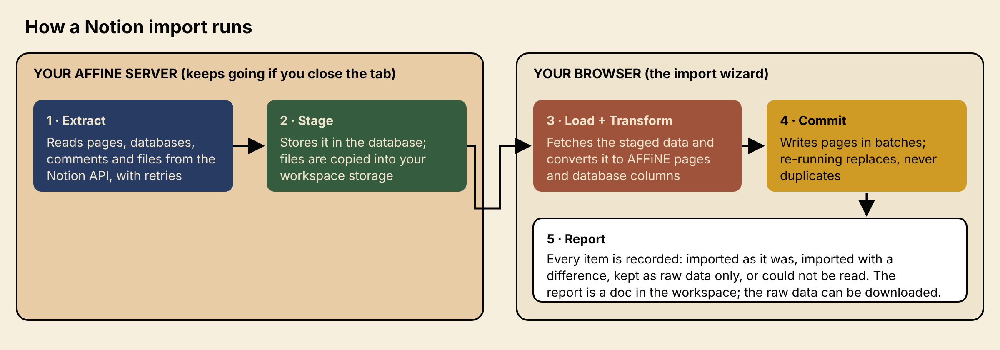

# Shelf home and Notion import

This fork adds two things to AFFiNE: a **Shelf** home page, and a **live Notion
import** that is built so nothing in a Notion workspace is silently lost. To run
it, see [.docker/custom/README.md](../.docker/custom/README.md).

Screens in this document are renderings of the Shelf scene and its parts, made
from the same code the app uses. Names and notification text in them are
samples.

## The Shelf home

The Shelf is the page a workspace opens on, and while it is showing it fills
the whole window: the header bar and the sidebar are hidden (this is not saved,
so your normal layout is back as soon as you open a doc). The scene is scaled to
fit the window; spare width or height is filled with the wall colour.

**Menu** (top right) is the way into the rest of the app: Search, New doc,
All docs, Journals, Collections, Tags, Trash, Settings, the palettes, and
**Show sidebar** if you want the usual sidebar back while you stay on the Shelf.
The eagle opens AI chat. If the server has AI switched off, the eagle says so
instead of doing nothing; an admin turns it on in the admin panel (AI / Copilot
settings).

The picture is decoration; the
things you can use are real buttons, so keyboard and screen-reader use works.

| In the picture                      | What it is                                                                     |
| ----------------------------------- | ------------------------------------------------------------------------------ |
| Each **book**                       | A doc you saved. Click it to open the doc.                                     |
| Each **bay** of the bookcases       | A folder. Bays page left and right when a folder holds more books than fit.    |
| Books at the front of a bay         | Your favorites.                                                                |
| The **pin board**                   | Six notes from the folder you edited last (its name is on the label above it). |
| The **eagle** and "Ask the eagle"   | Opens the AI chat.                                                             |
| The counter at the bottom left      | "14 of 126 documents opened": how many docs you have opened on this device.    |
| **Hints**                           | A short reminder of the above.                                                 |
| **Menu**                            | Show the shelf or browse as a list, open all docs, and change colors.          |
| The **plant** on the floating shelf | Your unread notifications (next section).                                      |

**Browse as a list** shows the same docs, folders and notifications as plain
lists, for small screens or when you prefer text.

**Colors.** The picture is drawn in palette roles (ink, blue, terracotta,
green, gold, cream), so the whole scene recolors. _Sunlit gold_ is the default
and uses the colors of the approved design; _Royal violet_ and _Blend_ are in
the menu.

The scene is a vector trace of the approved picture, so it stays sharp at any
width. It is stored in `scene-trace.ts`; `scripts/shelf-trace` regenerates it.
Patterns are inspired by Ndebele house painting, Ghanaian kente weaving and
Yoruba adire indigo cloth; the eagle is an original drawing.

## Notification flowers

Every **unread notification is one flower on the plant**.

- Terracotta flowers are people speaking to you (mentions and comments), gold
  flowers are invitations and requests, cream flowers are anything else.
- Click a flower to open a card with the notification. Use it as you would in
  the sidebar (open the doc, answer the invitation), or choose **Mark as read**.
- When the notification is read, **its flower disappears**. The others stay
  where they are.

- The plant holds up to 12 flowers. If you have more unread notifications, a
  "+N more" label appears, and the oldest ones bloom as room frees up.
- Flowers appear only when you are signed in to a cloud workspace. They share
  the list the sidebar uses, so the two always agree.
- Each flower is a button with a label such as "Unread notification 2 of 15".
  `Escape` closes the card and returns focus to its flower.

## Notion import

Import, then **Notion (live import from the API)**. It needs a cloud workspace.
It reads your pages, databases, files and comments through Notion's API, so it
does not depend on an export file.

**In the wizard**

1. Paste the token of an internal Notion integration (created at
   notion.so/profile/integrations, with the pages shared to it). The token goes
   to your AFFiNE server, which stores it encrypted; the browser does not keep it.
2. Choose everything shared with the integration, or only some pages or
   databases (one link or id per line). Optionally include comments on blocks.
3. Watch it run: reading from Notion, loading, converting, writing pages. You
   can **pause**, **resume** or **cancel**. If you close the tab it keeps
   running on the server, and reopening the wizard offers to continue it. If it
   stops (for example the token expired), paste the token again to continue.
4. When it finishes you get a summary, **Open the report**, and **Download the
   preserved file**.

**Nothing is silently lost.** Each item ends in one of four states, listed in a
report doc written into the workspace:

| Outcome                      | Meaning                                                                    |
| ---------------------------- | -------------------------------------------------------------------------- |
| Imported as they were        | Represented exactly.                                                       |
| Imported with a difference   | Imported, but something differs; the report says what.                     |
| Kept as raw data only        | AFFiNE cannot show it, so the original data is kept in the preserved file. |
| Could not be read or written | Listed with the reason; its raw data is kept where it was read.            |

Database columns that AFFiNE did not have are now supported: status, person,
files, relation, rollup and formula. Files are copied into your workspace
storage (up to 200 MB each by default). Running an import again replaces what
it imported earlier instead of duplicating it. Staged data is deleted from the
server after 7 days; the report stays.

Server settings (`notionImport` in `config/config.json`): `enabled`,
`apiVersion`, `retentionDays`, `maxFileBytes`, `maxTaskAttempts`.

## Where the code is

| Area                                         | Location                                                                                        |
| -------------------------------------------- | ----------------------------------------------------------------------------------------------- |
| Shelf page, scene, books, flowers            | `packages/frontend/core/src/desktop/pages/workspace/shelf/`                                     |
| Shelf rules (layout, palettes, flower slots) | `packages/frontend/core/src/modules/shelf/`                                                     |
| Scene tracer                                 | `packages/frontend/core/scripts/shelf-trace/`                                                   |
| Notion import in the browser                 | `packages/frontend/core/src/modules/notion-import/` and the wizard in `desktop/dialogs/import/` |
| Notion import on the server                  | `packages/backend/server/src/core/notion-import/`                                               |
| New database column types                    | `blocksuite/affine/blocks/database/src/properties/`                                             |
